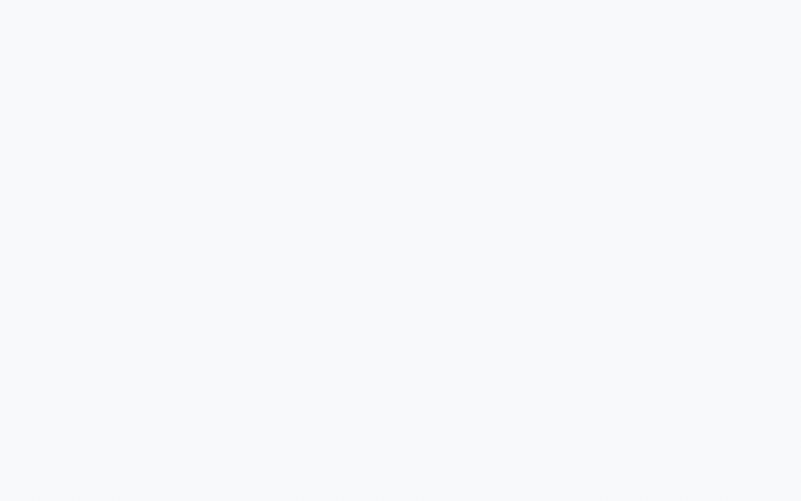
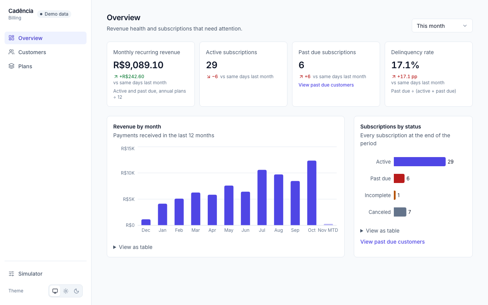
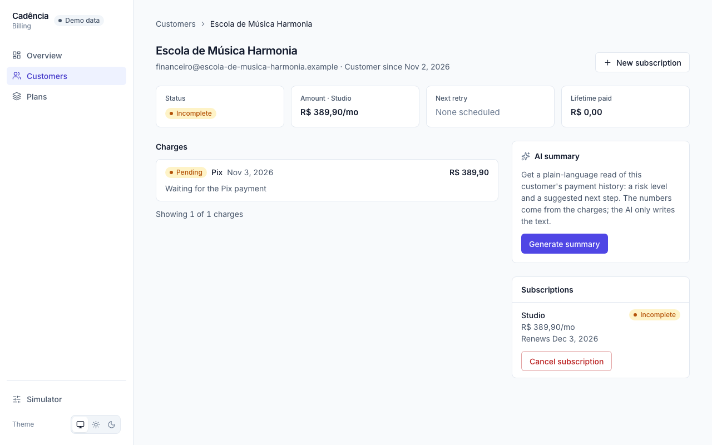
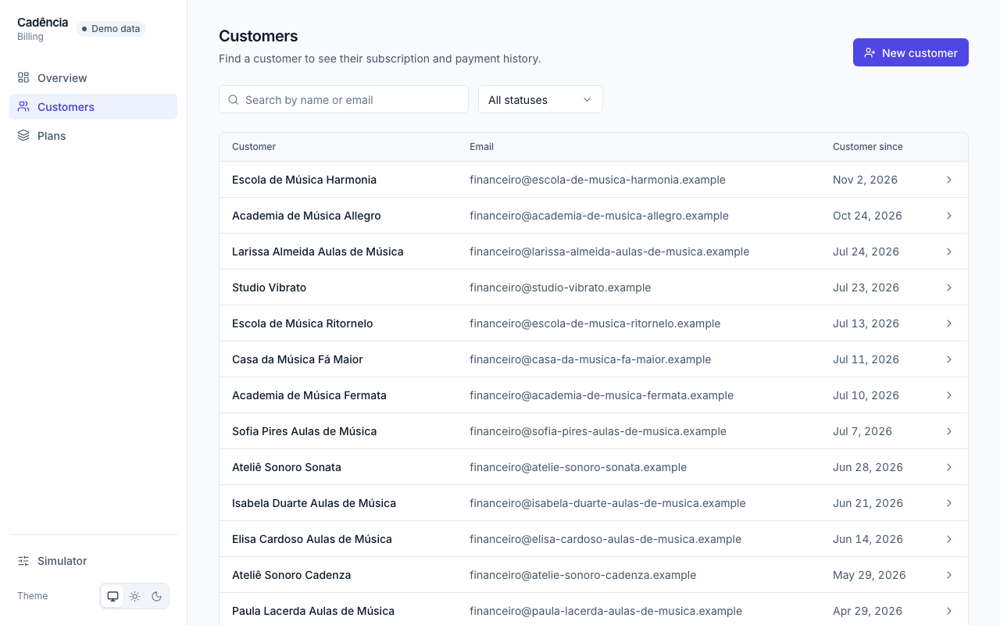
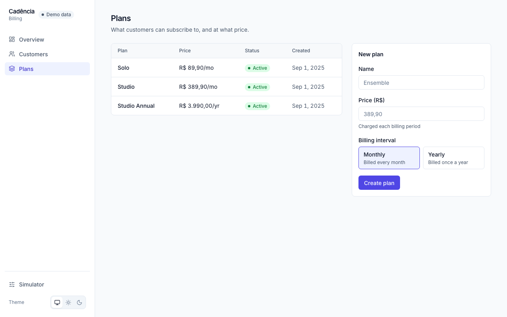

# Cadência Billing — Subscription Billing Dashboard

**Demo mode:** `pnpm install && pnpm dev` runs the whole app in the browser, with no backend and no sign-up. The build is a static site ready for any static host (`vercel.json` included).

A React 19 dashboard for billing operations at **Cadência**, a fictional Brazilian SaaS that sells monthly plans to music schools and teachers. It answers three questions fast: how revenue is doing, who is at risk, and why a payment failed. It consumes the [Subscription Payments API](https://github.com/gusants/subscription-payments-api) (NestJS) and ships with a demo mode that runs the same contract in the browser.



## What it does

- **Overview:** MRR, active and past-due subscriptions, delinquency rate with period-over-period deltas, revenue by month and subscriptions by status. Every chart has a table view.
- **Customers:** search, status filter and pagination kept in the URL.
- **Customer detail:** subscriptions, the charge timeline with failure reasons and the retry schedule (D+1, D+3, D+7), a manual retry with an optimistic update, and an AI summary that rates payment risk and suggests the next step.
- **Plans:** list and create plans.
- **Simulator:** approve a Pix, expire a boleto, force a card decline, run the retry clock, or simulate API and LLM failures, and watch every screen update.

| Overview                               | Customer detail                                    |
| -------------------------------------- | -------------------------------------------------- |
|    |  |
| **Customers**                          | **Plans**                                          |
|  |                      |

## Running it

Requires Node 24 and pnpm 10.

```bash
pnpm install
cp .env.example .env
```

### Demo mode (default)

```bash
pnpm dev
```

`VITE_API_MODE=demo` serves the API from a Mock Service Worker backed by an in-memory database. The data is seeded from a deterministic JSON file, persisted in `localStorage`, and changes as you use the app. **Reset demo** in the simulator restores it.

### Live API mode

Start the [payments API](https://github.com/gusants/subscription-payments-api) on `localhost:3000` (its README has the Docker Compose setup), then:

```bash
VITE_API_MODE=api pnpm dev
```

The dev server proxies `/api` to `VITE_API_URL` (default `http://localhost:3000`). The sidebar badge switches from **Demo data** to **Live API**. Simulator controls that only exist in the demo are disabled with the reason shown, and endpoints the API has not published yet show "Not available yet".

### Scripts

| Command                   | What it does                                                                |
| ------------------------- | --------------------------------------------------------------------------- |
| `pnpm test`               | Unit and component tests (Vitest, Testing Library, MSW)                     |
| `pnpm e2e`                | Playwright: the main flow and axe accessibility checks, desktop and mobile  |
| `pnpm generate:api-types` | Regenerates `src/api/generated/schema.d.ts` from the API's OpenAPI document |
| `pnpm record-demo`        | Re-records the GIF and screenshots above                                    |

## Technical decisions

- **One contract, two backends.** Types are generated from the payments API's OpenAPI document with `openapi-typescript`. The client (`openapi-fetch`) and the demo handlers (`openapi-msw`) are typed against the same paths, so a mock that drifts from the API does not compile. CI regenerates the types from the API's `main` branch and fails on drift. Endpoints the API has not shipped yet live in a small hand-written `PendingPaths` type until they are published.
- **MSW for the demo, not a fake client.** The demo goes through real `fetch` calls, status codes, validation errors and `Idempotency-Key` handling, so switching to the live API changes one environment variable and nothing in the UI code.
- **Server state in TanStack Query, URL state in TanStack Router.** Filters, pages and periods live in validated search params, so every view is shareable. The simulator invalidates exactly the queries an action touches.
- **TanStack Form for the forms, `useActionState` for the simulator.** Create customer, plan and subscription need field-level validation, server errors mapped back onto fields, and dirty and touched state, which TanStack Form handles well. Simulator actions are one-shot buttons with a pending state and a result message, the exact shape `useActionState` and `useFormStatus` were made for.
- **`useOptimistic` for manual retries.** The timeline shows the new attempt immediately and rolls back if the API refuses it.
- **Accessible by default.** React Aria Components for interactive widgets, a table alternative and a text summary for each chart, and axe checks in CI on every main screen, desktop and mobile, plus the dark theme.
- **Lean first load.** Routes are code-split and Recharts loads only when a chart renders.

## Stack

React 19, TypeScript, Vite, Tailwind CSS v4, React Aria Components, TanStack Router, Query and Form, Zod, Zustand, Recharts, MSW, Vitest, Playwright.

## Related

- [Subscription Payments API](https://github.com/gusants/subscription-payments-api): the NestJS backend this dashboard consumes (subscriptions, charges, retries, a fake payment gateway, idempotency).
